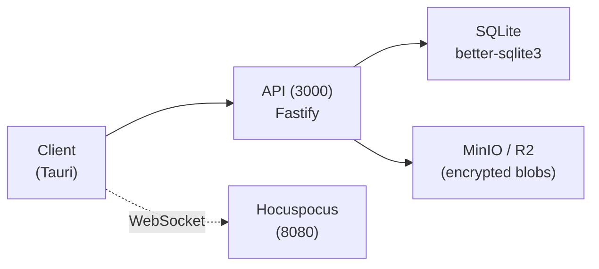

# Beaver Sync

The Zero-knowledge encrypted sync backend for Beaver Notes with: ML-KEM post-quantum encryption, real-time collaboration, team workspaces, SSO, audit logs, and self-hostable enterprise deployment.

## Architecture



- **API**: Fastify server handling auth, sync, workspaces, admin, SSO, webhooks
- **Hocuspocus**: Standalone WebSocket relay for real-time multiplayer editing
- **Storage**: S3-compatible (MinIO dev, Cloudflare R2 prod); all blobs ML-KEM encrypted
- **Database**: SQLite via better-sqlite3; zero-config, embeddable
- **Error monitoring**: Optional Glitchtip / Sentry (DSN-based, no-op when unset)

## Features

| Feature | Free | Basic ($4/mo) | Pro ($9/mo) | Team ($12/seat/mo) | Enterprise |
|---|---|---|---|---|---|
| Version history | ✗ | 30 days | ✓ | ✓ | ✓ |
| Encrypted cloud sync | BYO Cloud | ✓ | ✓ | ✓ | ✓ |
| Cloud storage | ✗ | 4 GB | 10 GB | 50 GB | Unlimited |
| End-to-end encryption | ✓ | ✓ | ✓ | ✓ | ✓ |
| Quantum-resistant encryption | (only for Beaver Sync) | ✓ | ✓ | ✓ | ✓ |
| Real-time multiplayer editing | (editor only on invite) | ✓ | ✓ | ✓ | ✓ |
| Team workspaces & permissions | ✗ | ✗ | ✗ | ✓ | ✓ |
| Guest access | ✗ | ✗ | ✗ | ✓ | ✓ |
| Admin dashboard | ✗ | ✗ | ✗ | ✓ | ✓ |
| Audit logs | ✗ | ✗ | ✗ | ✗ | ✓ |
| SSO / SAML | ✗ | ✗ | ✗ | ✗ | ✓ |
| GDPR data export & deletion | ✓ | ✓ | ✓ | ✓ | ✓ |
| Device limit | Unlimited | 5 | Unlimited | Unlimited | Unlimited |

## Quick Start (Development)

```bash
cp .env.example .env
bash scripts/generate-keys.sh
docker compose up -d
```

## Enterprise Self-Hosted

```bash
docker compose -f docker-compose.enterprise.yml up -d
```

All features (SSO, audit logs, admin, workspaces, real-time collab) work offline with `ENTERPRISE_MODE=true`. Optional license key validation via `LICENSE_SECRET`.

## Fly.io Deployment

### Prerequisites
1. [Fly.io](https://fly.io) account + `flyctl` CLI installed
2. Cloudflare R2 bucket created with API token
3. DNS records pointing to Fly for your custom domain

### Deploy
```bash
# 1. Configure secrets
cp fly/.env.secrets.example fly/.env.secrets
# Edit fly/.env.secrets with real values

# 2. Run deploy script
bash fly/deploy.sh
```

### Update
```bash
# Deploy individual services
fly deploy fly/api/
fly deploy fly/hocuspocus/
fly deploy fly/glitchtip/
```

### Rollback
```bash
fly releases rollback -a <app-name>
```

### Monitor
```bash
fly logs -a beaver-sync-api
fly status --app beaver-sync-api
```

## License

Apache 2.0
