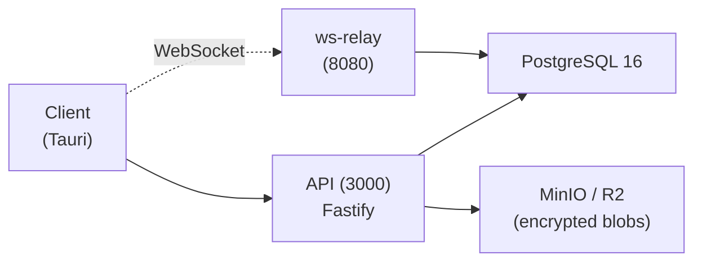

# Beaver Sync

The Zero-knowledge encrypted sync backend for Beaver Notes with: ML-KEM post-quantum encryption, real-time collaboration, team workspaces, SSO, audit logs, and self-hostable enterprise deployment.

## Architecture



- **API**: Fastify server handling auth, sync, workspaces, admin, SSO, webhooks
- **WebSocket relay** (`src/ws-relay.js`): y-websocket-compatible relay for real-time multiplayer editing; authenticates each connection against the API
- **Storage**: S3-compatible (MinIO dev, Cloudflare R2 prod); all blobs ML-KEM encrypted
- **Database**: PostgreSQL 16 — single source of truth; `LISTEN/NOTIFY` fans out sync events
- **Error monitoring**: Optional Glitchtip / Sentry (DSN-based, no-op when unset)

## Features

| Feature | Free | Starter | Pro | Team | Enterprise |
|---|---|---|---|---|---|
| Notes & editor | ✓ | ✓ | ✓ | ✓ | ✓ |
| Sync container | Folder only | Personal workspace | Personal workspace | Personal + shared team workspaces | Personal + shared team workspaces |
| Receive shared notes | ✓ (as note collaborator) | ✓ | ✓ | ✓ | ✓ |
| Invite / share notes | ✗ | ✓ | ✓ | ✓ | ✓ |
| Collaborators (page-scoped) | ✗ | ✗ | ✗ | ✓ | ✓ |
| Team workspaces & permissions | ✗ | ✗ | ✗ | ✓ | ✓ |
| Admin dashboard | ✗ | ✗ | ✗ | ✓ | ✓ |
| Audit logs | ✗ | ✗ | ✗ | ✗ | ✓ |
| SSO / SAML | ✗ | ✗ | ✗ | ✗ | ✓ |
| Self-hosted | ✗ | ✗ | ✗ | ✗ | ✓ |
| Cloud storage | 0 | 10 GB | 50 GB | 100 GB + 25 GB × seats | Contractual |
| Version history | ✗ | 30 days | 1 year | 1 year | Contractual |
| Device limit | Unlimited | Unlimited | Unlimited | Unlimited | Unlimited |

## Local testing (production mode)

Run the backend exactly like production (VPS docker compose) locally:

```bash
PLAN_OVERRIDE=team docker compose -f docker-compose.test.yml up -d
```

- `PLAN_OVERRIDE` forces every account to the given tier (free|starter|pro|team|enterprise).
- `EMAIL_ENABLED=false` disables all Resend sends in this environment.
- Seed a tier-specific account: `npm run seed:tier -- team tester@example.com`
- Frontend: point `VITE_BEAVER_SYNC_API_URL=http://localhost:4000` and
  `VITE_BEAVER_SYNC_WS_URL=ws://localhost:8080` (defaults already).

## Quick Start (Development)

```bash
cp .env.example .env
bash scripts/generate-keys.sh
docker compose up -d
```

This starts Postgres, MinIO, the API, the WebSocket relay (`ws-relay`), and a scheduled Postgres backup sidecar. The API connects to Postgres at `localhost:5432` (default credentials in `.env.example`).

## Enterprise Self-Hosted

```bash
docker compose -f docker-compose.enterprise.yml up -d
```

Includes Postgres, MinIO, GlitchTip, the API, and the WebSocket relay. All features (SSO, audit logs, admin, workspaces, real-time collab) work offline with `ENTERPRISE_MODE=true`. Optional license key validation via `LICENSE_SECRET`.

## Deployment (VPS)

Full guide: [docs/deployment.md](docs/deployment.md).

### Prerequisites
1. A VPS with Docker + Docker Compose
2. DNS records pointing your domain at the VPS
3. External or co-located Postgres reachable via `DATABASE_URL`
4. Cloudflare R2 bucket (or self-hosted MinIO) for blob storage

### Deploy
```bash
# 1. Configure secrets
cp .env.example .env
bash scripts/generate-keys.sh   # JWT + ML-KEM keys
# Edit .env with real values

# 2. Start the stack
docker compose -f docker-compose.yml -f docker-compose.prod.yml up -d --build
```

CI/CD alternative: push to `main` with repo variables `DEPLOY_TARGET=vps` and secrets `VPS_HOST`, `VPS_USERNAME`, `VPS_SSH_KEY` — GitHub Actions runs tests then deploys over SSH.

### Update / Rollback
```bash
git pull
docker compose -f docker-compose.yml -f docker-compose.prod.yml up -d --build

# Rollback: check out the previous tag/commit and redeploy the same way
```

### Scaling

The API is stateless — scale it horizontally with the overlay (adds Redis as the shared rate-limit store):

```bash
export REDIS_URL=redis://redis:6379
docker compose -f docker-compose.yml -f docker-compose.scale.yml up -d --scale api=3
```

The WebSocket relay must stay a single instance (rooms live in memory); Caddy's sticky routing keeps clients pinned to it.

### Backups

A `pg-backup` sidecar runs `scripts/backup-postgres.sh` on a schedule (`BACKUP_INTERVAL_SECONDS`, retention via `BACKUP_RETENTION_DAYS`, dumps land in `./backups`). Verify restores periodically:

```bash
scripts/restore-postgres.sh backups/pg-<timestamp>.sql.gz <target-db>
```

### Monitor
```bash
docker compose logs -f api ws-relay
docker compose ps
```

## License

Apache 2.0
