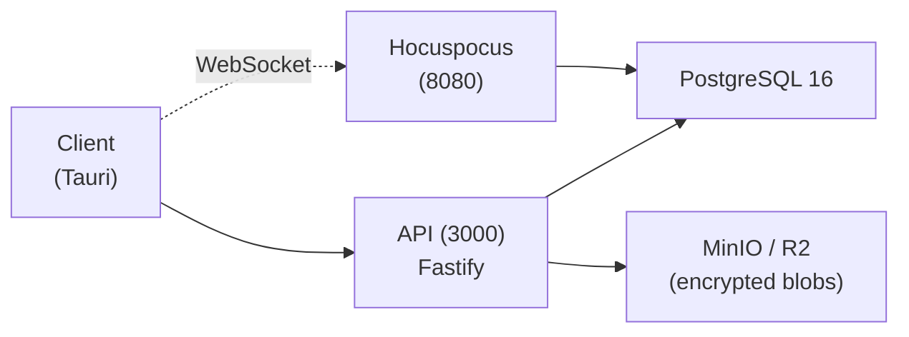

# Beaver Sync

The Zero-knowledge encrypted sync backend for Beaver Notes with: ML-KEM post-quantum encryption, real-time collaboration, team workspaces, SSO, audit logs, and self-hostable enterprise deployment.

## Architecture



- **API**: Fastify server handling auth, sync, workspaces, admin, SSO, webhooks
- **Hocuspocus**: Standalone WebSocket relay for real-time multiplayer editing
- **Storage**: S3-compatible (MinIO dev, Cloudflare R2 prod); all blobs ML-KEM encrypted
- **Database**: PostgreSQL 16 (single-node dev, 3-node HA on Fly.io)
- **Error monitoring**: Optional Glitchtip / Sentry (DSN-based, no-op when unset)

## Features

| Feature | Free | Starter | Pro | Team | Enterprise |
|---|---|---|---|---|---|
| Notes & editor | ✓ | ✓ | ✓ | ✓ | ✓ |
| Sync container | Folder only | Personal workspace | Personal workspace | Personal + shared team workspaces | Personal + shared team workspaces |
| Receive shared notes | ✓ (as note collaborator) | ✓ | ✓ | ✓ | ✓ |
| Invite / share notes | ✗ | ✓ | ✓ | ✓ | ✓ |
| Collaborators (page-scoped) | ✗ | ✗ | ✗ | ✓ | ✓ |
| Team workspaces & permissions | ✗ | ✗ | ✗ | ✓ | ✓ |
| Admin dashboard | ✗ | ✗ | ✗ | ✓ | ✓ |
| Audit logs | ✗ | ✗ | ✗ | ✗ | ✓ |
| SSO / SAML | ✗ | ✗ | ✗ | ✗ | ✓ |
| Self-hosted | ✗ | ✗ | ✗ | ✗ | ✓ |
| Cloud storage | 0 | 10 GB | 50 GB | 100 GB + 25 GB × seats | Contractual |
| Version history | ✗ | 30 days | 1 year | 1 year | Contractual |
| Device limit | Unlimited | 5 | Unlimited | Unlimited | Unlimited |

## Local testing (production mode)

Run the backend exactly like production (fly.io) locally:

```bash
PLAN_OVERRIDE=team docker compose -f docker-compose.test.yml up -d
```

- `PLAN_OVERRIDE` forces every account to the given tier (free|starter|pro|team|enterprise).
- `EMAIL_ENABLED=false` disables all Resend sends in this environment.
- Seed a tier-specific account: `npm run seed:tier -- team tester@example.com`
- Frontend: point `VITE_BEAVER_SYNC_API_URL=http://localhost:4000` and
  `VITE_BEAVER_SYNC_WS_URL=ws://localhost:8080` (defaults already).

## Quick Start (Development)

```bash
cp .env.example .env
bash scripts/generate-keys.sh
docker compose up -d
```

This starts Postgres, MinIO, the API, and Hocuspocus. The API connects to Postgres at `localhost:5432` (default credentials in `.env.example`).

## Enterprise Self-Hosted

```bash
docker compose -f docker-compose.enterprise.yml up -d
```

Includes Postgres, MinIO, GlitchTip, API, and Hocuspocus. All features (SSO, audit logs, admin, workspaces, real-time collab) work offline with `ENTERPRISE_MODE=true`. Optional license key validation via `LICENSE_SECRET`.

## Fly.io Deployment

### Prerequisites
1. [Fly.io](https://fly.io) account + `flyctl` CLI installed
2. Cloudflare R2 bucket created with API token
3. DNS records pointing to Fly for your custom domain
4. Fly Postgres cluster (or external Postgres) with `DATABASE_URL`

### Deploy
```bash
# 1. Configure secrets
cp fly/.env.secrets.example fly/.env.secrets
# Edit fly/.env.secrets with real values (including DATABASE_URL)

# 2. Run deploy script
bash fly/deploy.sh
```

The deploy script creates API, Hocuspocus, and GlitchTip apps, sets secrets, deploys with rolling strategy, and configures your custom domain.

### Update
```bash
# Deploy individual services
fly deploy fly/api/
fly deploy fly/hocuspocus/
fly deploy fly/glitchtip/
```

### Rollback
```bash
fly releases rollback -a <app-name>
```

### Scaling

#### Add API replica
```bash
fly m clone --app beaver-sync-api
```

#### Upgrade machine
```bash
fly m scale shared-cpu-2x --app beaver-sync-api
```

#### Scale Postgres to 3-node
```bash
fly mpg scale --plan basic --replicas 3
```

### Monitor
```bash
fly logs -a beaver-sync-api
fly status --app beaver-sync-api
```

## License

Apache 2.0
